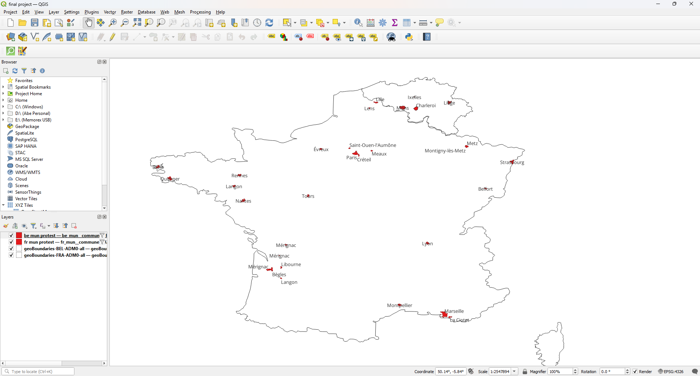
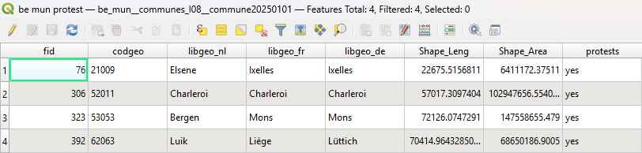

# Map of 2026 French Lycée Protests

The data visualized includes country outlines for France and Belgium as well as municipalities within both countries.

**Links to data:**
https://en.wikipedia.org/wiki/2026_French_lyc%C3%A9e_protests

https://www.data.gouv.fr/datasets/decoupage-administratif-communal-francais-issu-d-openstreetmap

https://www.atlas-belgique.be/index.php/en/resources/map-data/

https://www.geoboundaries.org/countryDownloads.html

I created this map because I have been following the French student protest movement that is currently underway. I am interested in workers' struggles internationally.

This map was created by overlaying municipality data for France and Belgium over their respective country outlines.

 Within the attribute tables for each country's municipalities, I created a new field in which I manually indicated which municipalities were reported to have incidents or mobilizations as per the Wikipedia article.
 
 
 
  I filtered the visible municipalities to only include those specific aforementioned locations. I changed the colors within the layers' symbology tab and then added simple text labels based on the fields that listed municipality names.

**Link to index.html page:** [file:///D:/nmp/map%20671/map671-final-abevidya/index.html](index.html)
 
The projection for the original data was EPSG 4326 except for the Belgium municipalities layer which used EPSG 3812. I was unable to get this layer to display its symbology in another projection. 